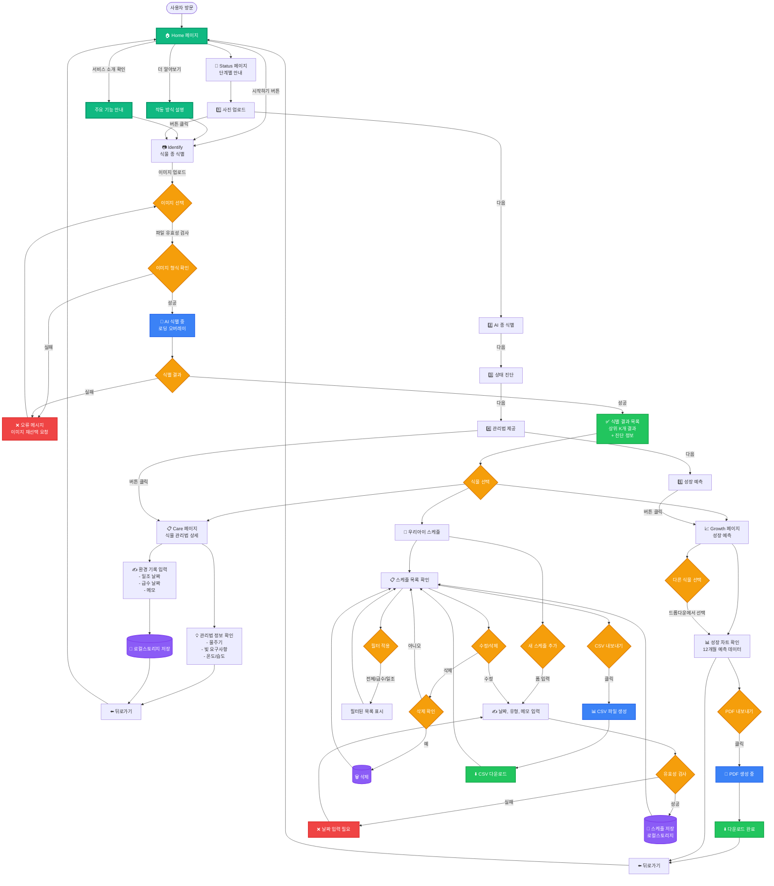
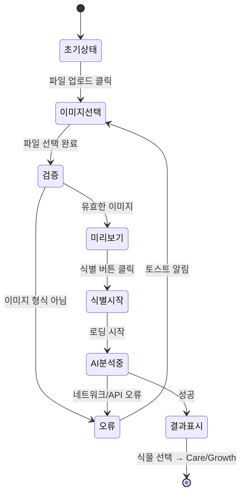
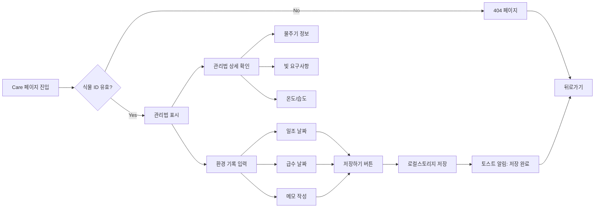
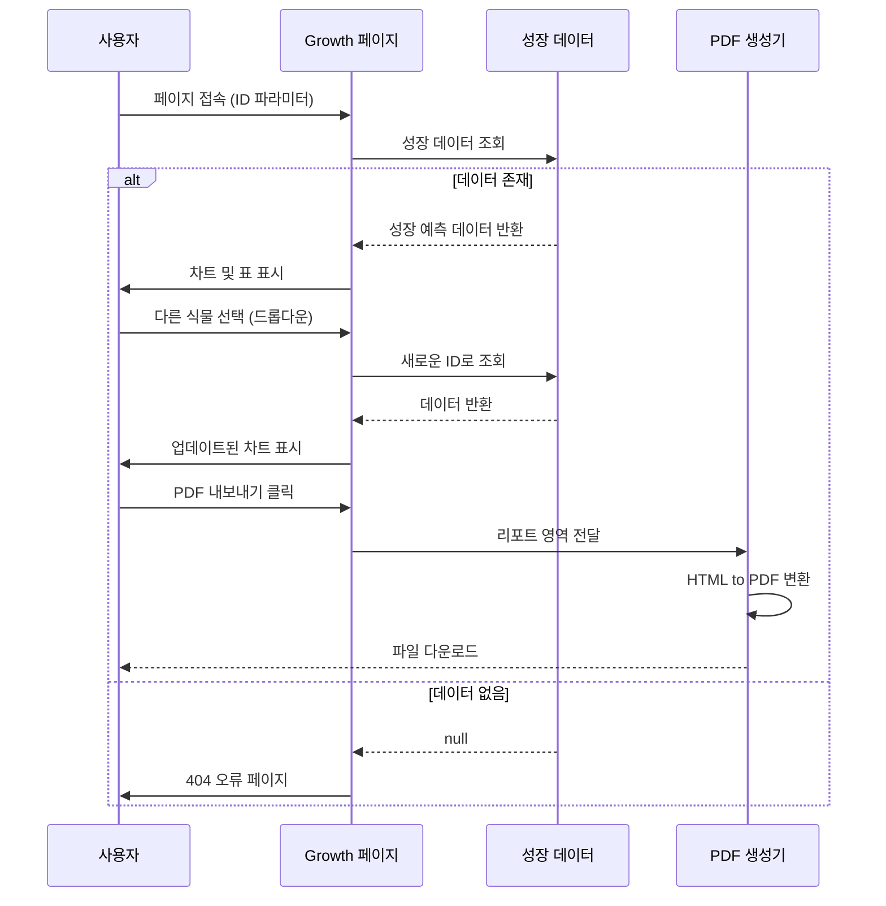
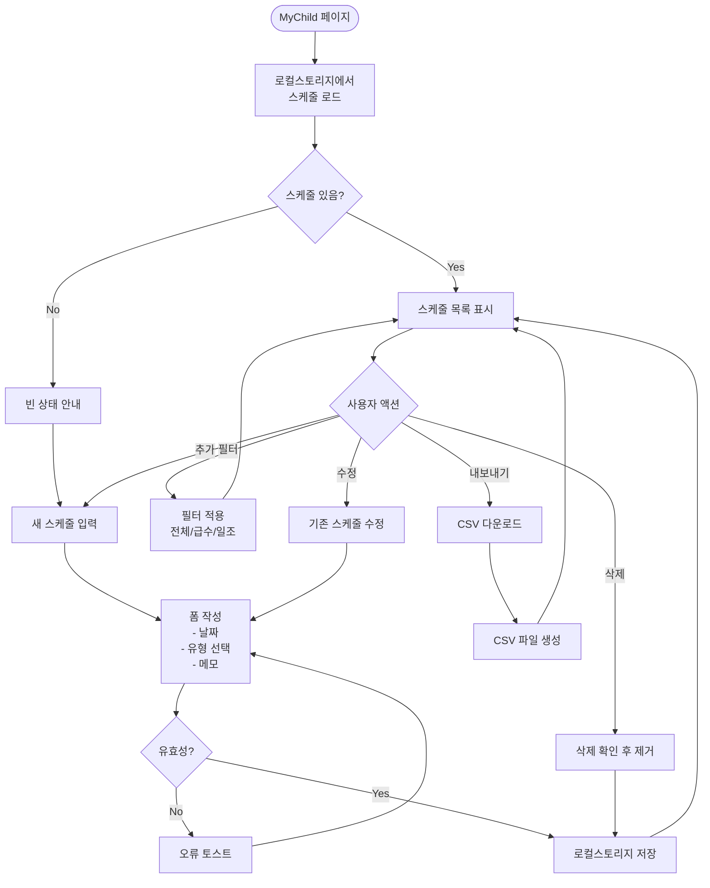
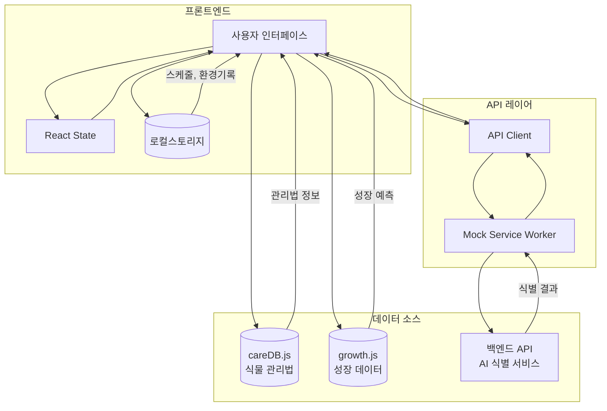
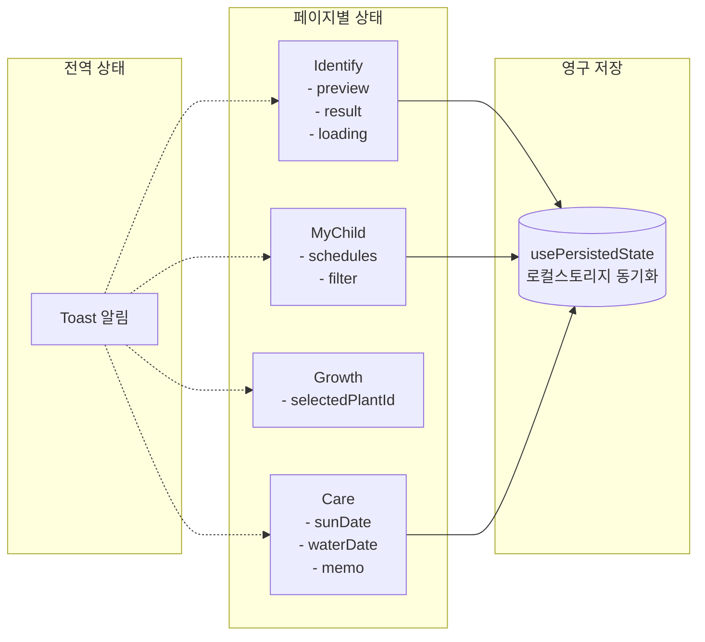
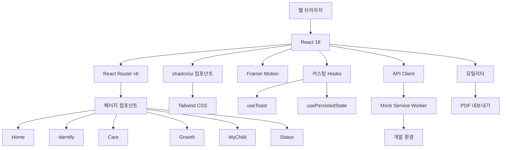
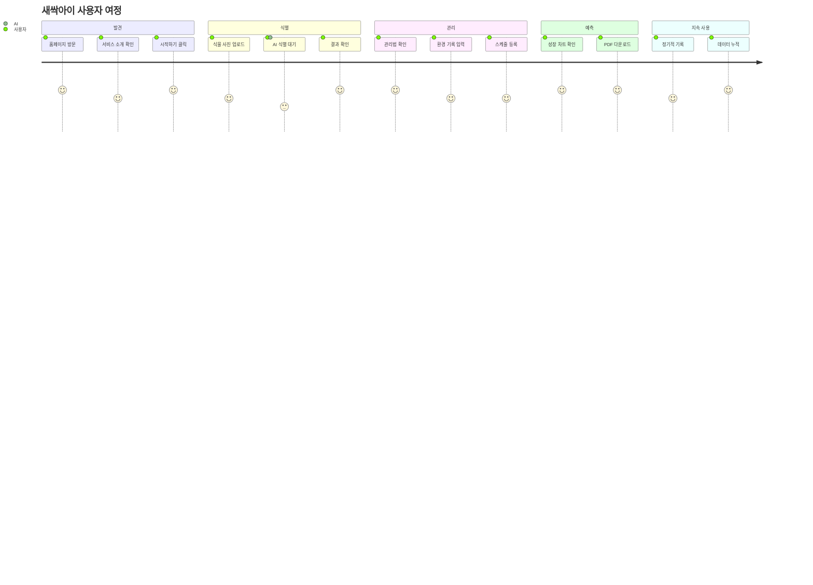

# 새싹아이 사용자 플로우

## 전체 애플리케이션 플로우 다이어그램

## 페이지별 상세 플로우

### 1. Identify 페이지 (식물 식별)

### 2. Care 페이지 (식물 관리법)

### 3. Growth 페이지 (성장 예측)

### 4. MyChild 페이지 (스케줄 관리)

## 데이터 흐름

## 상태 관리

## 기술 스택 흐름

## 사용자 여정 맵

---

## 주요 특징

### 🎯 핵심 기능
1. **AI 기반 식물 식별** - 이미지 업로드로 간편한 종 분류
2. **맞춤형 관리법** - 각 식물별 상세 관리 가이드
3. **성장 예측** - 12개월 성장 데이터 시각화
4. **스케줄 관리** - 일조/급수 일정 기록 및 추적
5. **데이터 내보내기** - PDF 리포트 및 CSV 다운로드

### 💾 데이터 저장
- **로컬스토리지**: 스케줄, 환경 기록, 식별 결과
- **세션 지속성**: 페이지 새로고침 시에도 데이터 유지
- **내보내기 지원**: PDF(성장 리포트), CSV(스케줄)

### 🎨 UI/UX
- **반응형 디자인**: 모바일/태블릿/데스크톱 최적화
- **애니메이션**: Framer Motion을 활용한 부드러운 전환
- **접근성**: ARIA 레이블, 키보드 네비게이션 지원
- **토스트 알림**: 사용자 액션에 대한 즉각적인 피드백

